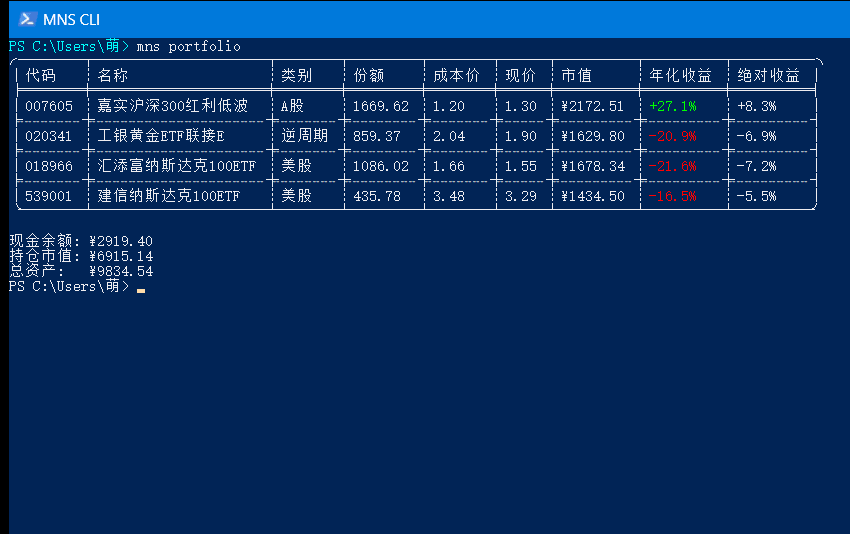

# CLI 快速上手

命令行工具 `mns` 和桌面端共用同一份本地数据（`~/.mns/`）和同一套规则。喜欢终端的人用它更快，桌面端用户偶尔也需要它做初始化和回测。

## 安装与首次初始化

从源码构建（需要 Rust 工具链）：

```bash
cargo build --release
./target/release/mns --version
```

或用 npm 安装预编译版本（支持 macOS Apple Silicon、Linux x64、Windows x64）：

```bash
npm install -g @never-sleeps/mns-cli
```

第一次使用的完整流程：

```bash
mns init                        # 建立 ~/.mns/config.toml 和 mns.db
mns cash deposit 10000          # 入金
mns add 018966 "汇添富纳斯达克100ETF" us_stocks
mns buy 018966 1000 1.234       # 登记一笔已成交的买入
mns config params               # 查看全部可调参数和默认值
mns today                       # 刷价并生成今日报告
```



## 一周怎么用

| 时间 | 做什么 | 命令 |
|---|---|---|
| 第一次 | 初始化、入金、登记已有持仓 | `mns init` → `mns cash deposit` → `mns add` |
| 每周五 | 刷价并生成决策报告 | `mns today` |
| 发薪日 | 分配定投金额，成交后补录 | `mns plan --monthly 3000` → `mns buy` |
| 临时想加仓 | 看一眼冷静期提示 | `mns guard` |
| 每季度 | 更新数据，和账户镜像对一次 | `mns backtest update-data` → `mns backtest mirror` |
| 平时 | 看绩效、翻流水、看市场概况 | `mns performance` / `mns history` / `mns market` |

## 哪些命令会写数据

> [!WARNING]
> `report` 和 `today` 会写入本地情绪快照和报告，不是只读命令。`performance`、`history`、`portfolio`、`market` 才是只读的。
