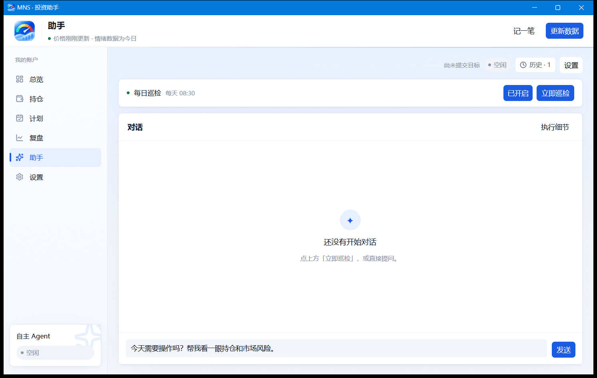

# 桌面端：AI 助手

## 助手页是什么

助手页通过 **ACP 协议**调用你已经安装的编码 Agent（默认会找 `opencode`）。MNS 把当天的报告作为唯一数据源交给它，让它按固定格式给出结论，比如「今天需要操作吗？帮我看一眼持仓和市场风险」。

## 隐私与安全边界

> [!IMPORTANT]
> MNS 本身不内置模型，也不保存 API Key。模型和凭据始终留在你自己的 Agent 配置里。

- Agent 的结论以 JSON 存档到 `~/.mns/agent/`，可以只读回放；
- Agent **不会写你的账本**，也不会执行交易；
- 历史对话可以在助手页的「历史记录」里回放或删除。

## 日常巡检

托盘菜单里的「立即巡检」会自动发起一次当天的检查任务，结论回到助手页查看。也可以开启定时巡检，让它在每天的固定时间自动跑一次。

## 使用建议

- 把结论当作「第二双眼睛」，而不是指令。它看到的数据只有当天报告，和你看到的一样；
- 巡检结论如果和报告主体冲突，以报告（本地引擎）为准。
