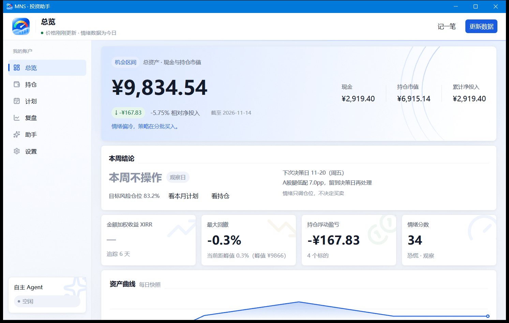

# 桌面端：总览与导航

桌面应用和命令行是**同一套引擎**，只是换了种呈现方式——报告、桌面端和历史审计共用同一套信号与策略代码，不存在「展示一套、回测另一套」。

## 主窗口布局

左侧是导航栏，六个页面按使用频率排列：

| 页面 | 看什么 |
|---|---|
| 总览 | 净值、资产曲线、今日结论 |
| 持仓 | 每只标的的成本、盈亏、仓位偏离 |
| 计划 | 本月定投分配 |
| 复盘 | 组合 XIRR、实际最大回撤、纪律统计 |
| 助手 | 外接 AI Agent 的对话界面 |
| 设置 | 参数、主题、开机自启动 |

## 总览页

打开应用首先看到的是总览页：

- **净值卡**：账户总市值与现金，下方是数据新鲜度；
- **资产曲线**：历史净值走势；
- **今日结论**：当天报告的核心建议——多数日子它会告诉你「今天不用动手」，这是正常的。

数据不是实时推送的，点右上角「更新数据」按钮（或按 `Ctrl+R`）刷新行情与情绪快照。

## 日常使用节奏

- **每周五**（决策日）：打开总览看一次结论，需要调仓就照报告执行；
- **发薪日**：去计划页看本月定投分配；
- **平时**：不用打开。托盘图标常驻，有值得注意的事会体现在托盘简报里。
