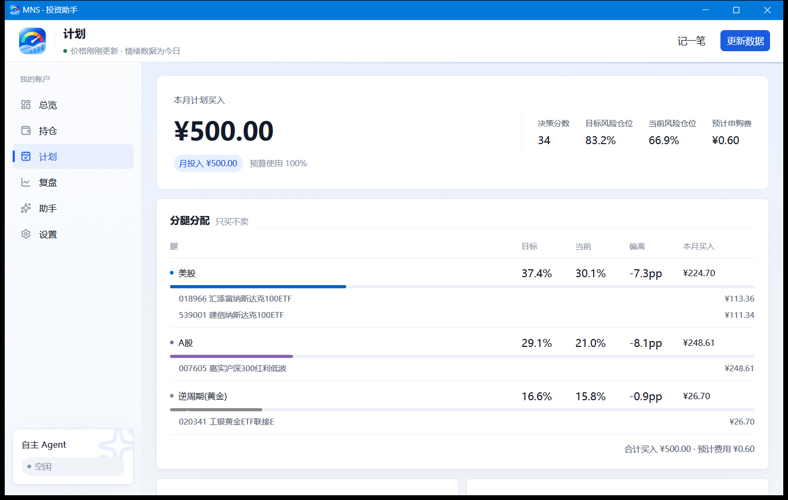

# 桌面端：计划页

## 本月定投

计划页展示当月的定投分配方案：根据当前情绪档位和目标仓位，把一笔新钱按比例分到三条资产腿。

## 怎么用

1. 在计划页设定本月金额（比如发薪日的 3,000 元）；
2. 按分配方案在券商分别下单——建议直接在基金 App 里设置**自动定投**，让执行不依赖记性；
3. 成交后回持仓页（或 CLI `mns buy`）补录登记。

## 原则

- 计划**只买不卖**，作用是把储蓄率和执行节奏固定下来；
- 它不是收益增强工具——定投摊平的是成本，摊不出超额收益；
- 临时想加大投入时，先跑一次 `mns guard` 看冷静期提示。
