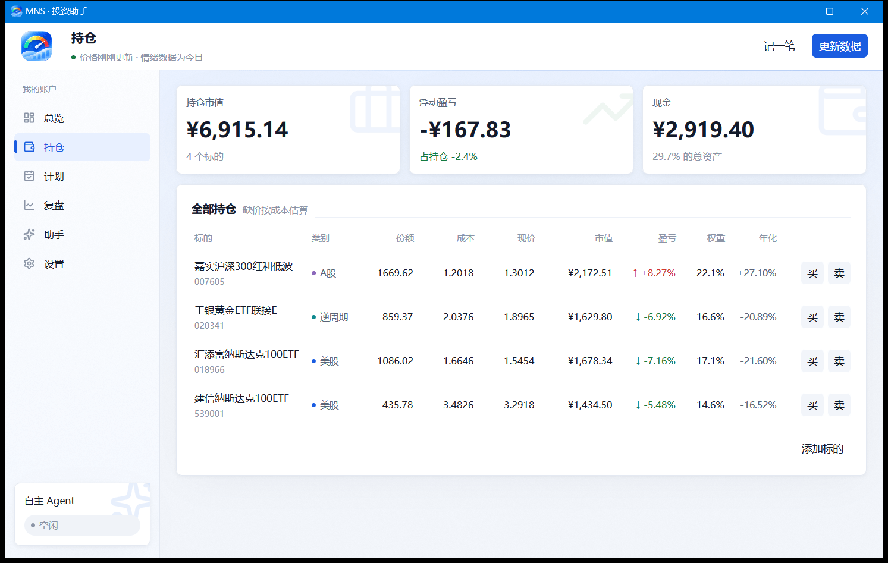

# 桌面端：持仓与账本

## 持仓页

持仓页列出每只标的的：

- 持有份额、成本单价、现价；
- 市值、浮动盈亏、年化收益；
- 当前仓位与目标仓位的偏离。

## 本地账本：先成交，后登记

MNS 不连券商。买卖需要你在券商完成之后自己登记，桌面端持仓页提供和 CLI 等价的录入入口：

| 操作 | 说明 |
|---|---|
| 入金 | 外部转入现金，按 XIRR 口径记账 |
| 买入 | 登记一笔**已成交**的买入（代码、金额、价格） |
| 卖出 | 登记一笔已成交的卖出 |
| 出金 | 外部转出现金 |
| 添加标的 | 登记新基金，选择资产类别（美股宽基 / A 股宽基 / 逆周期） |

持仓、成本、现金和流水会保持一致：**现金不足或卖出超过持仓会直接报错**，账本不会出现对不上的状态。

> [!WARNING]
> 「现金纠错」只用来修正记错的余额，不应该拿来记入金——入金必须走入金入口，否则收益率口径（XIRR）会失真。

## 复盘页

- 组合 **XIRR**（考虑资金进出的时间价值的年化收益）；
- **实际最大回撤**：账户净值从最高点跌到最低点的真实幅度；
- 纪律统计：本年交易笔数对照预算（默认 10~20 次）。

复盘页是只读的，不会写库。
