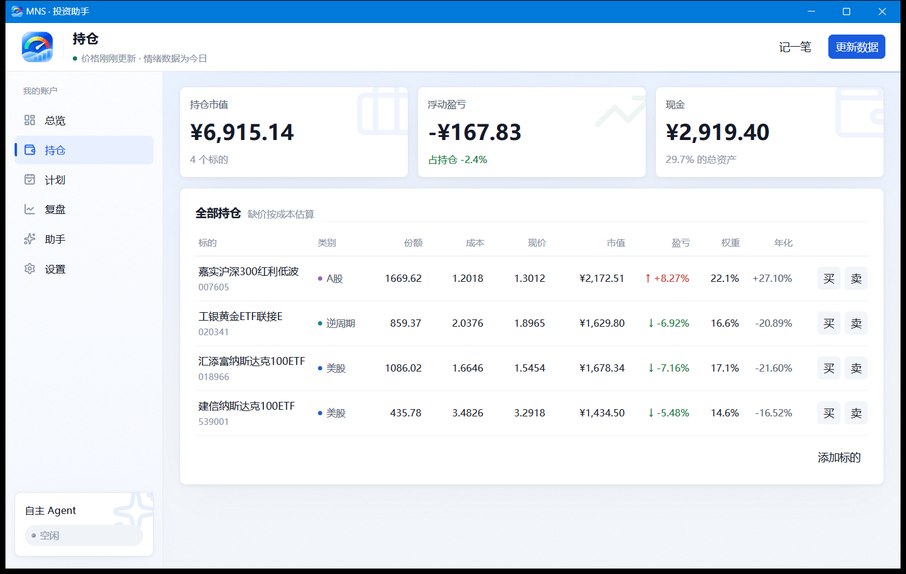

# 桌面端：持仓与账本

## 持仓页

持仓页列出每只标的的：

- 持有份额、成本单价、现价；
- 市值、浮动盈亏、年化收益；
- 当前仓位与目标仓位的偏离。

## 本地账本：先成交，后登记

MNS 不连券商。买卖需要你在券商完成之后自己登记，桌面端持仓页提供和 CLI 等价的录入入口：

| 操作 | 说明 |
|---|---|
| 入金 | 外部转入现金，按 XIRR 口径记账 |
| 买入 | 登记一笔**已成交**的买入（代码、金额、价格） |
| 卖出 | 登记一笔已成交的卖出 |
| 出金 | 外部转出现金 |
| 添加标的 | 按代码或名称搜索基金（也可手填代码），再亲自选归属类别（美股 / A 股 / 逆周期） |

搜索建议只做两件事：给候选、给依据。类别默认**不替用户选**——猜错一条腿会让整张再平衡表算错，所以宁可多点一次。选中候选后，行的下方会写明「为什么建议归这条腿」；债券、货基、FOF 与跨市场 QDII 会直接说明无法归属，而不是硬塞进某条腿。

两条边界：

- **只收场外基金**。场内 ETF/LOF（接口里 `ISBUY` 与 `MINSG` 为空）在搜索列表里会标成「场内·不收」，选中后直接说明原因、不允许提交。场内要在证券账户按市价成交，成本、份额与分红都不在 MNS 的口径里，混进账本只会让偏离算错——要跟踪就添加它对应的**场外联接基金**。
- 6 位基金代码可以留空名称，保存时按代码自动带出；非 6 位代码（如美股代码）必须自己填名称。

持仓、成本、现金和流水会保持一致：**现金不足或卖出超过持仓会直接报错**，账本不会出现对不上的状态。

> [!WARNING]
> 「现金纠错」只用来修正记错的余额，不应该拿来记入金——入金必须走入金入口，否则收益率口径（XIRR）会失真。

## 复盘页

- 组合 **XIRR**（考虑资金进出的时间价值的年化收益）；
- **实际最大回撤**：账户净值从最高点跌到最低点的真实幅度；
- 纪律统计：本年交易笔数对照预算（默认 10~20 次）。

复盘页是只读的，不会写库。
