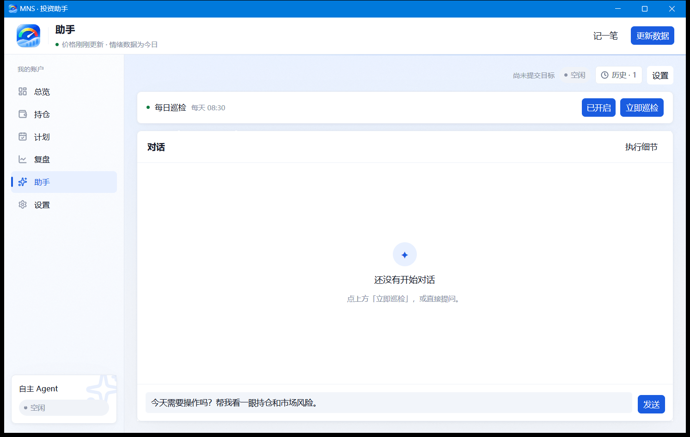

# 桌面端：巡检

## 巡检页是什么

巡检页是 MNS 的「第二双眼睛」：它通过 **ACP 协议**调用你已经安装的编码 Agent
（默认会找 `opencode`），把当天的报告作为唯一数据源交给它，让它按固定格式给出
结论——今天该不该动、要不要调仓、有哪些风险需要留意。

页面只做四件事：显示当前（或最近一次）巡检的时间线与结论、提供「立即巡检」、
列出历史报告供只读回放、以及在原输入框位置把这份巡检接力给管家窗口继续聊。

## 定时巡检由管家守护进程调度

开启「每日巡检」并设定时间后，**管家守护进程**（`mns-butlerd`）会在到点时自动
跑一次巡检，即使主窗口已经关闭也不会漏。同一天只会落一份报告：GUI 手动起跑和
守护进程的定时巡检共用 `~/.mns/agent/last-review` 这个标记，先到的先算。

## 手动立即巡检

点页面顶部的「立即巡检」即可立刻跑一次（会顺带刷新价格）。运行中按钮不可重复
点击，需要中断时用引导卡里的「停止」。

## 历史报告

巡检结束后，报告写入 `~/.mns/agent/reviews/`，顶部的「历史」抽屉按时间倒序列出
标题、日期、来源、预览与状态。点开是**只读回放**：正文与结论卡片，不再还原执行
轨迹；删除按钮需要二次确认。回放页底部的「带这份巡检问管家」同样会把这份旧报告
带给管家，不需要手动去 `@` 里翻。

## 追问去管家窗口

巡检页不提供自由对话：它只按纪律出结论。想知道「为什么」「那我的持仓怎么办」
或者随便聊聊，请点引导卡里的按钮——管家窗口能结合账本与记忆继续回答。

这个按钮是接力棒，不是只开一个空窗口：

- 它会把当前这份巡检作为引用一起带过去（回放页同理），管家窗口打开即已挂好；
  巡检还在跑时按钮不出现——跑完才能引用，运行中的正文只有一句开场白；
- 结论里有「待确认」时，按钮变成「带这份巡检问管家」，标题提示有 N 件只有你
  知道的事，并把第一条预填进输入框——按回车就能带着整份报告继续问；
- 输入框里已经有字时不会覆盖，你打完自己的问题照常发送。

「待确认」是例外通道而不是待办清单：巡检最多只问 2 条、能不问就不问，而且只问
「只有你知道、答案会改变今天结论」的封闭事实（是否已成交/已入金、限购是否解除、
资金何时到账）。观点、偏好、预测和展开讨论都留给管家，不会写进结论里。

## 隐私与安全边界

> [!IMPORTANT]
> MNS 本身不内置模型，也不保存 API Key。模型和凭据始终留在你自己的 Agent 配置里。

- 巡检结论存档在 `~/.mns/agent/reviews/`，可以只读回放；
- Agent **不会写你的账本**，也不会执行交易；
- 使用 MNS 默认的 opencode 时，巡检按 Agent 默认开放 shell、联网、编辑与子代理；
  MNS 只加一条 best-effort 护栏，拒绝会改账本的 `mns` 子命令和 `init`（`buy`、
  `sell`、`cash set`、`today` 等），避免误操作。这不是沙箱：换用其他 ACP agent
  时这条护栏不生效，请检查它那边的权限设置；
- 巡检结论如果和报告主体冲突，以报告（本地引擎）为准。
