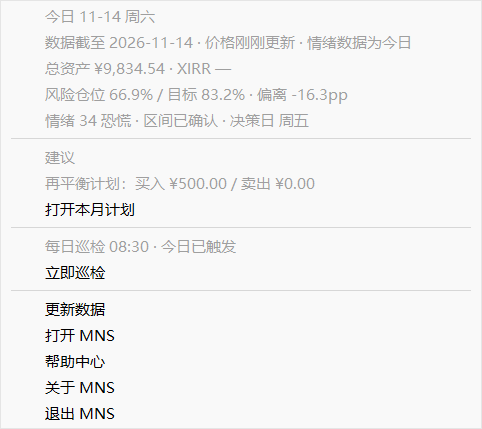

# 桌面端：托盘、自启动与设置

## 系统托盘

托盘常驻之后，右键图标可以快速：

- 查看当日简报（数据、建议、巡检状态）；
- **打开帮助中心**（就是你现在看的这个窗口）；
- 立即巡检、停止当前任务；
- 打开主窗口、更新数据、退出。

托盘是只读的简报面板，不是第二个仪表盘。值得注意的事会直接写在菜单文字里。

## 命令行入口

`mns-gui --butler` 直接打开管家窗口：没有实例在运行时主界面保持隐藏，只弹
管家会话；已有实例在运行时只通知它打开管家窗口，不会多开一个进程。

## 开机自启动

设置页可以开启开机自启动。它写的是**系统自身的登录项**（Windows 任务管理器「启动」页 / macOS 登录项），不会额外常驻一个后台进程。

- 登录自启动带 `--tray` 参数：只常驻托盘，不弹窗口；
- Windows 发布版没有控制台窗口，不会闪黑框。

## 设置页

| 设置组 | 内容 |
|---|---|
| 风险档位 | 仓位曲线高低、目标区间 |
| 决策节奏 | 决策日（默认周五）、偏离带宽 |
| 外观 | 主题 |
| Agent | 外接 Agent 的可执行文件与巡检时间 |
| 管家 | 主动开口开关、频控（每天/每周上限、去重、静音时段）、打开管家窗口 |
| 系统 | 开机自启动 |

设置写入 `~/.mns/gui.toml` 与 `~/.mns/config.toml`，与 CLI 共享。

## 数据都在哪里

所有运行数据都在 `~/.mns/` 下，**备份就是复制这个目录**，换机器时一起带走即可：

| 路径 | 内容 |
|---|---|
| `config.toml` | 风险档位、仓位曲线、偏离带、成本等设置 |
| `mns.db` | 持仓、交易流水、现金、情绪快照 |
| `reports/` | 每日报告存档 |
| `agent/` | AI 对话和决策记录 |
| `agent/butler/` | 管家的唤醒状态、记忆、任务与通知队列 |
| `agent/events.jsonl` | 本地行为记录（可在设置页关闭或清除） |
| `gui.toml` | 桌面端设置（含外部 Agent 的 CLI 与模型） |

MNS 本身不上传任何数据，没有云同步，也没有遥测。唯一会离开本机的是管家
窗口里的对话：它交给外部 ACP agent 回答，问题和账本摘要因此会走到 agent
所配置的服务，provider 与密钥都在那份配置里，MNS 不保存。判定、开口与
通知始终在本机。
