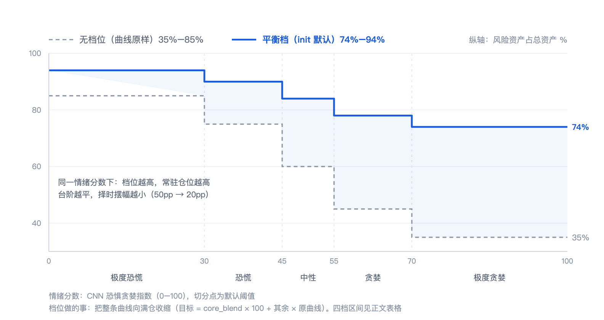
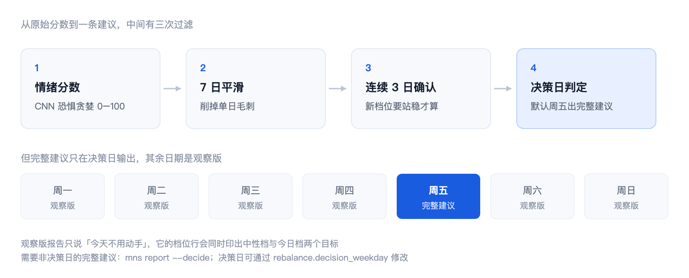

# 情绪指数与目标仓位

## 输入：CNN Fear & Greed 指数

MNS 用 CNN 的 Fear & Greed 指数作为唯一的市场情绪输入，把 0 到 100 的分数映射成一条**五档目标仓位曲线**。曲线的锚点是极度恐慌 85%、恐慌 75%、中性 60%、贪婪 45%、极度贪婪 35%——市场越**恐慌**，允许的仓位越高（别人恐惧时贪婪）；越**贪婪**，允许的仓位越低（别人贪婪时恐惧）。

`mns init` 会再套一层**风险档位**，把整条曲线朝 100% 收拢一次。档位不改变「恐慌时多拿」的方向，只抬高常驻仓位、压窄摆幅：

| 档位 | core_blend | 五档目标仓位 | 中性档 |
|---|---|---|---|
| none 无档位 | 0 | 35%–85% | 60% |
| steady 稳健 | 0.4 | 61%–91% | 76% |
| balanced 平衡（init 默认） | 0.6 | 74%–94% | 84% |
| aggressive 进取 | 0.8 | 87%–97% | 92% |



所以报告里会出现两个数，它们并不矛盾：**中性档目标**是配置算出来的常驻值（平衡档 84%），**今日档目标**是当前分数落在哪一档（平衡档下恐慌档 90%）。前者回答「我平时该有多少仓位」，后者回答「按今天的情绪可以有多少」。

## 为什么要平滑和确认

日频的情绪数据对周频、月频的配置来说噪音太大。所以 MNS 在计算前做两步处理：

1. **7 天平滑**：先把情绪分数做 7 天移动平均，削掉单日的毛刺；
2. **连续 3 天确认**：新档位必须连续 3 天站稳才算数，防止一天的大涨大跌就把仓位目标来回搬。

最后只在**决策日（默认周五）**输出完整的调仓建议。其他日子只出观察版报告，提醒你今天不用动手。如果确实需要在非决策日看建议，可以用 `mns report --decide` 强制生成。



## 情绪快照是本地资产

每次运行 `mns today` / `mns report` 时，情绪数据会落库为本地快照。平滑和确认都可以离线计算，不依赖接口每次都能连上——行情和情绪数据都做了多源回退。

这也意味着 `report` 和 `today` **不是只读命令**：它们会写入本地情绪快照和报告。`performance`、`history`、`portfolio` 才是只读的。

## 仓位曲线可调

目标区间的上下限、五档的切分点、平滑窗口、确认天数都可以在配置里调整：

```bash
mns config params    # 查看全部可调参数和默认值
```

风险档位（risk profile）决定整条曲线的高低：`none` 摆幅最大、常驻仓位最低；往 `steady → balanced → aggressive` 走，常驻仓位越来越高、摆幅越来越窄：

```bash
mns config profile steady    # none | steady | balanced | aggressive
```

这不是「越保守越安全」的开关。回测里回撤最小的是 `none`（曲线原样执行），档位换来的是更少的交易和更平滑的行为，代价是市场高位时也留着更多仓位。
